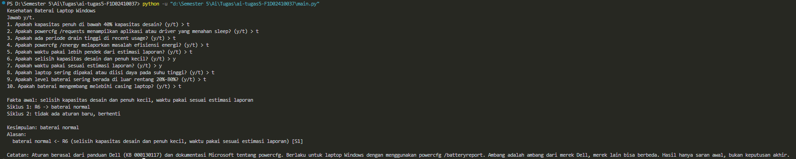
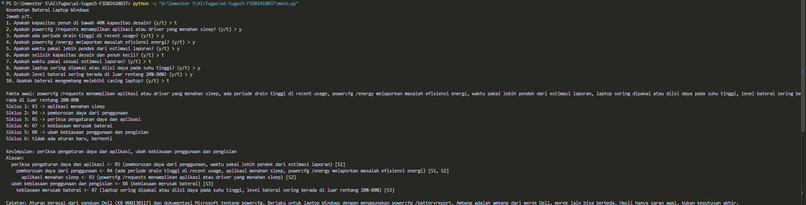
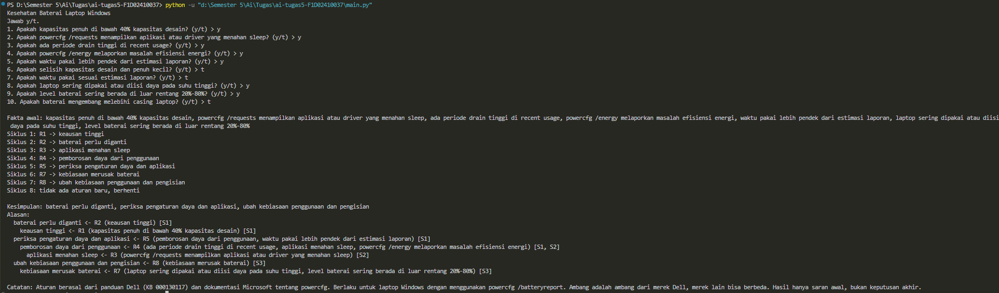
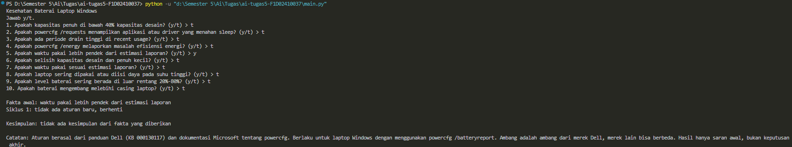

# Sistem Pakar Kesehatan Baterai Laptop Windows

**Nama:** [Azizurrifki]
**NIM:** [F1D02410037]

## Topik dan Cara Menjalankan

Sistem pakar sederhana untuk menyimpulkan kondisi baterai laptop Windows dari data laporan `powercfg /batteryreport`, hasil `powercfg /requests` dan `powercfg /energy`, serta kebiasaan pemakaian.

- **Bahasa:** Python [versi, cek dengan `python --version`]
- **Menjalankan:** `python main.py`
- **File aturan:** `kb_baterai.json`

## Sumber

| Kode | Judul | Penerbit | URL | Diakses |
| --- | --- | --- | --- | --- |
| S1 | How to Generate a Battery Report Using the POWERCFG Command | Dell | https://www.dell.com/support/kbdoc/en-us/000130117 | 13 Nov 2026 |
| S2 | Powercfg command-line options | Microsoft Learn | https://learn.microsoft.com/en-us/windows-hardware/design/device-experiences/powercfg-command-line-options | 13 Nov 2026 |
| S3 | Caring for your battery in Windows | Microsoft Support | https://support.microsoft.com/en-us/windows/experience/power-battery/caring-for-your-battery-in-windows | 13 Nov 2026 |

## Tabel Aturan

| Aturan | IF | THEN | Sumber |
| --- | --- | --- | --- |
| R1 | kapasitas penuh di bawah 40% kapasitas desain | keausan tinggi | S1 |
| R2 | keausan tinggi | baterai perlu diganti | S1 |
| R3 | `powercfg /requests` menampilkan aplikasi atau driver yang menahan sleep | aplikasi menahan sleep | S2 |
| R4 | ada periode drain tinggi di recent usage **OR** aplikasi menahan sleep **OR** `powercfg /energy` melaporkan masalah efisiensi energi | pemborosan daya dari penggunaan | S1, S2 |
| R5 | pemborosan daya dari penggunaan **AND** waktu pakai lebih pendek dari estimasi laporan | periksa pengaturan daya dan aplikasi | S1 |
| R6 | selisih kapasitas desain dan penuh kecil **AND** waktu pakai sesuai estimasi laporan | baterai normal | S1 |
| R7 | laptop sering dipakai atau diisi daya pada suhu tinggi **OR** level baterai sering di luar rentang 20%-80% | kebiasaan merusak baterai | S3 |
| R8 | kebiasaan merusak baterai | ubah kebiasaan penggunaan dan pengisian | S3 |
| R9 | baterai mengembang melebihi casing laptop | hentikan pemakaian laptop segera | S3 |

Rantai aturan: R1 → R2, R3 → R4 → R5, dan R7 → R8. Pemetaan fakta ke kesimpulan di R4, R7, dan R8 adalah penarikan kesimpulan penulis dari isi sumber.

## Metode: Forward Chaining

Program memulai dari fakta yang dijawab "ya" oleh user, lalu menjalankan aturan yang syaratnya terpenuhi dan hasilnya belum ada di memori. Hasilnya ditambahkan ke memori dan proses diulang sampai tidak ada aturan baru. Aturan yang hasilnya sudah ada tidak dijalankan lagi supaya program tidak berulang tanpa henti.

Alasan memilih forward chaining: data awalnya sudah tersedia (laporan baterai dan pengamatan user), sehingga tinggal diturunkan menjadi kesimpulan tanpa perlu menentukan tujuan di awal.

## Kasus Uji

Program diuji dengan empat kasus. Kasus 1 sampai 3 menghasilkan kesimpulan, sedangkan kasus 4 adalah **kasus negatif**.

| # | Jawaban "ya" (nomor pertanyaan) | Kesimpulan | Aturan yang dipakai |
| --- | --- | --- | --- |
| 1 | 6, 7 | baterai normal | R6 |
| 2 | 2, 3, 4, 5, 8, 9 | periksa pengaturan daya dan aplikasi; ubah kebiasaan penggunaan dan pengisian | R3 → R4 → R5 dan R7 → R8 |
| 3 | 1, 2, 3, 4, 5, 8, 9 | baterai perlu diganti; periksa pengaturan daya dan aplikasi; ubah kebiasaan penggunaan dan pengisian | R1 → R2, R3 → R4 → R5, dan R7 → R8 |
| 4 | 5 | **tidak ada kesimpulan** | tidak ada |

### Kasus 1: baterai normal

**Fakta "ya":** selisih kapasitas desain dan penuh kecil, waktu pakai sesuai estimasi laporan. Hanya R6 yang terpenuhi, sehingga hasilnya `baterai normal`.

### Kasus 2: periksa pengaturan daya dan ubah kebiasaan

**Fakta "ya":** `powercfg /requests` menampilkan aplikasi atau driver yang menahan sleep, ada periode drain tinggi di recent usage, `powercfg /energy` melaporkan masalah efisiensi energi, waktu pakai lebih pendek dari estimasi laporan, laptop sering dipakai atau diisi daya pada suhu tinggi, level baterai sering di luar rentang 20%-80%. Dua rantai berjalan bersamaan: R3 → R4 → R5 menghasilkan `periksa pengaturan daya dan aplikasi`, dan R7 → R8 menghasilkan `ubah kebiasaan penggunaan dan pengisian`.

### Kasus 3: baterai perlu diganti

**Fakta "ya":** semua fakta kasus 2 ditambah kapasitas penuh di bawah 40% kapasitas desain. Rantai R1 → R2 ikut berjalan sehingga `baterai perlu diganti` muncul bersama dua kesimpulan dari kasus 2.

### Kasus 4: tidak ada kesimpulan (kasus negatif)

**Fakta "ya":** waktu pakai lebih pendek dari estimasi laporan saja. R5 membutuhkan `pemborosan daya dari penggunaan` yang tidak pernah terbentuk, sehingga tidak ada aturan yang terpenuhi dan program menampilkan bahwa tidak ada kesimpulan.

## Batas Keberlakuan

Pengetahuan dalam program ini berasal dari panduan Dell (S1), dokumentasi Microsoft Learn (S2), dan panduan Microsoft Support untuk Windows 11 (S3). Ambang 40% adalah ambang dari Dell dan rentang 20%-80% adalah anjuran Microsoft, sehingga merek atau model lain bisa memiliki ambang berbeda. Sistem hanya berlaku untuk laptop Windows dengan baterai lithium-ion yang dapat menghasilkan laporan `powercfg`. Hasilnya adalah saran awal, bukan keputusan akhir, dan untuk kondisi baterai yang membahayakan sebaiknya menghubungi pusat servis resmi.

## Penggunaan Alat Bantu AI

Saya menggunakan claude untuk brainstorming topik, meyusun draft README.md, serta membantu memperbaiki kode.